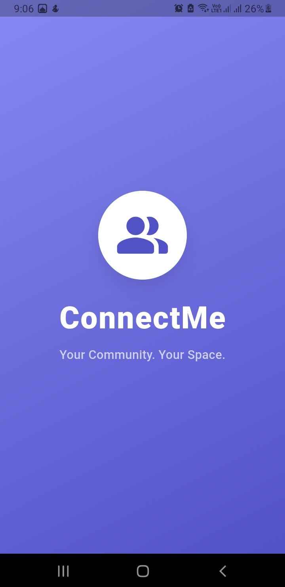
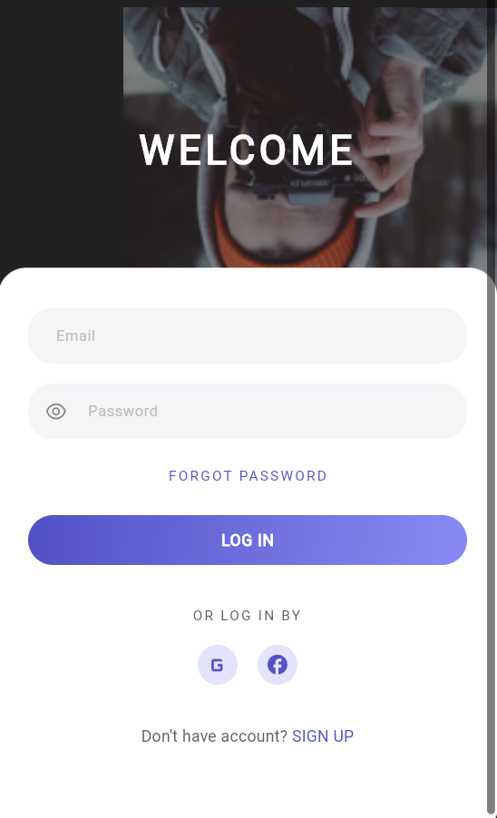
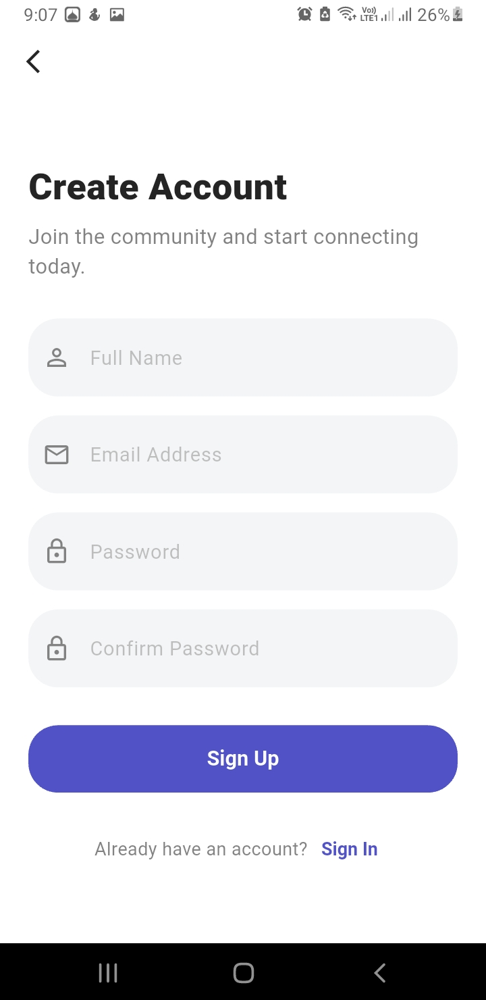
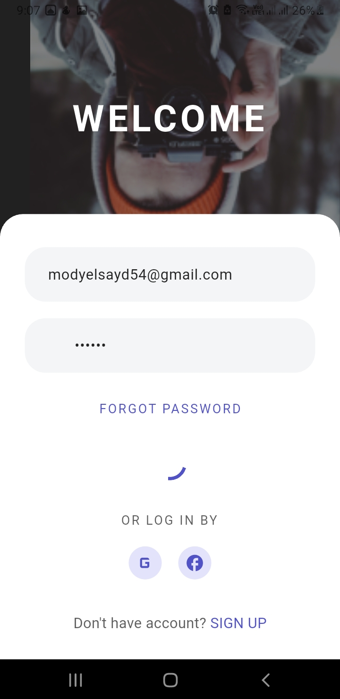
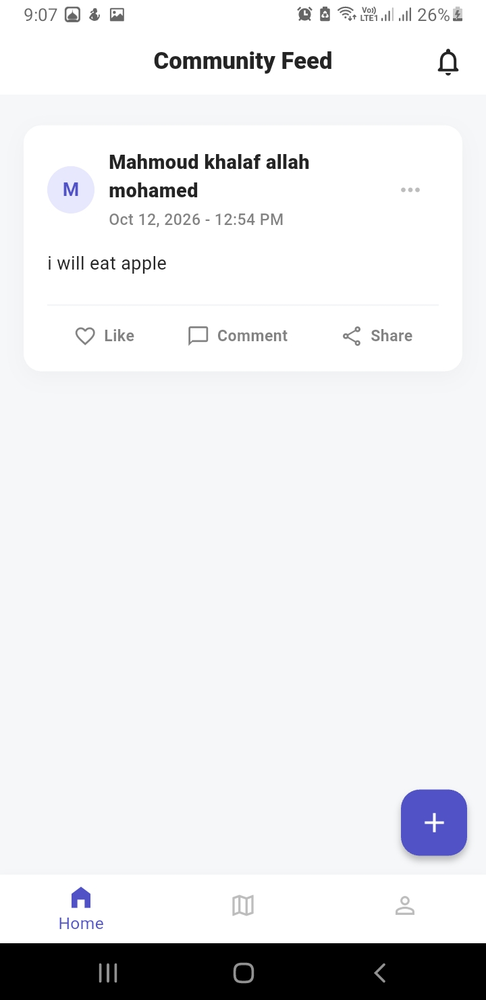
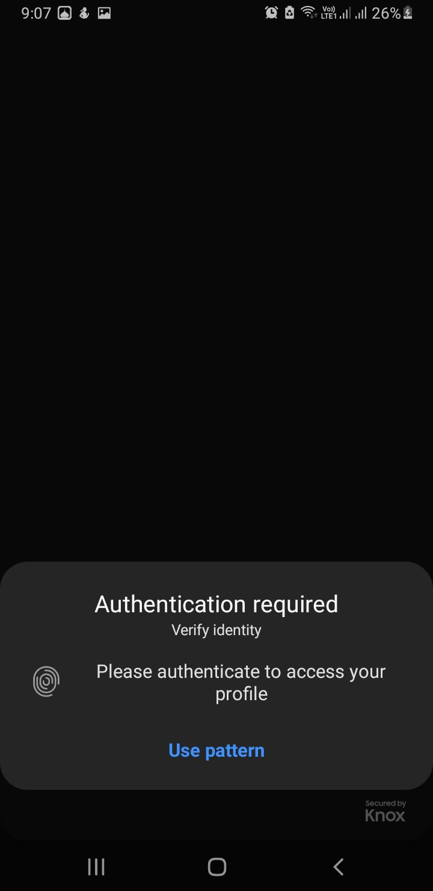
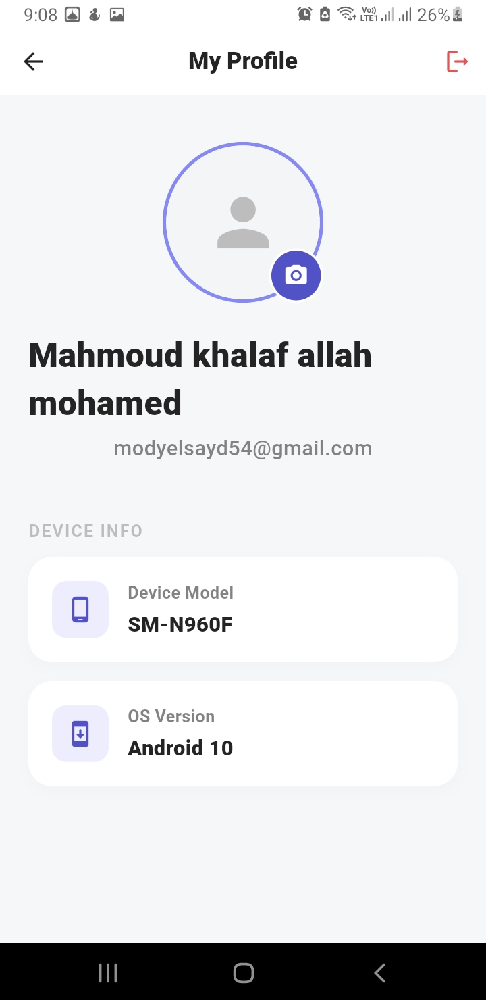

# ConnectMe Community App

Welcome to **ConnectMe**, a production-ready Flutter social community application built to demonstrate advanced mobile engineering concepts, including strict Clean Architecture, software design patterns, Firebase integration, and native device capabilities. 

This project is the final capstone delivery showcasing end-to-end mobile development from UI design implementation to beta distribution.

---

## 📱 Project Overview

**ConnectMe** allows users to:
- Authenticate securely via Firebase.
- View a real-time feed of community posts.
- Create new posts that are instantly synchronized with Cloud Firestore.
- Access a secure Profile Screen guarded by Biometric Authentication (Fingerprint/FaceID).
- View their device hardware information within the profile.
- Update their profile picture using the native camera/gallery.
- View a map of community members across different cities using Google Maps.

---

## 🏗️ Architecture & Design Patterns

This application rigidly follows **Clean Architecture** to ensure separation of concerns, testability, and scalability.

### Folder Structure
The codebase is divided into three distinct layers:
1. **Domain Layer (`lib/domain/`)**: The core of the app. Contains Entities (business objects) and abstract Repositories. It has no dependencies on Flutter or third-party libraries.
2. **Data Layer (`lib/data/`)**: Handles data retrieval and storage. Contains Models (data transfer objects with `fromJson`/`toJson`), Data Sources (Firebase, Local Cache), and Repository Implementations.
3. **Presentation Layer (`lib/presentation/`)**: Handles the UI and State Management. Contains Screens, custom Widgets, and BLoCs/Cubits.

### Software Design Patterns Applied

- **Singleton Pattern**: Applied to the `FirestoreService` and Dependency Injection container (`GetIt`). Ensures only one instance of the database connection exists throughout the app's lifecycle to prevent memory leaks and redundant connections. *(See: `lib/injection.dart`)*
- **Factory Pattern**: Applied in `PostRepositoryImpl` to dynamically select the appropriate Data Source (`FirestorePostDataSource` vs `LocalPostDataSource`) based on network availability or specific fetch requests. *(See: `lib/data/repositories/post_repository_impl.dart`)*
- **Builder Pattern**: Used for constructing the `UserModel`. Since user profiles can have optional fields (like profile picture URLs that are added later), the Builder pattern allows step-by-step construction of the user object without constructor pollution. *(See: `lib/data/models/user_model.dart`)*
- **Dependency Injection**: Managed via `get_it`. Decouples class creation from class usage, adhering to the Dependency Inversion principle (SOLID).

---

## 🛠️ Technologies & Packages

* **Framework:** Flutter SDK & Dart
* **State Management:** `flutter_bloc` (using Cubit)
* **Backend:** Firebase Authentication, Cloud Firestore, Firebase Storage
* **Distribution:** Firebase App Distribution
* **Native Integrations:**
  * `local_auth` (Biometrics)
  * `image_picker` (Camera/Gallery access)
  * `google_maps_flutter` (Interactive mapping)
  * `device_info_plus` (Hardware info retrieval)
* **Dependency Injection:** `get_it`

---

## 📸 Screenshots

*(Note: The following images represent the required visual deliverables for the capstone)*

### App Previews
| View 1 | View 2 |
| :---: | :---: |
|  |  |

| View 3 | View 4 |
| :---: | :---: |
|  |  |

| View 5 | View 6 |
| :---: | :---: |
|  |  |

---

## 🚀 Firebase App Distribution Process

As part of the production lifecycle, a beta build of this application was distributed to testers.

1. **Build Generation:** A release APK was generated using `flutter build apk --release`.
2. **Firebase Upload:** The APK was uploaded to the Firebase App Distribution console.
3. **Tester Invitation:** Email invitations were sent to a configured tester group.

### Distribution Proof
| View 7 | View 8 |
| :---: | :---: |
|  |  |

---

## ⚙️ Setup & Installation

To run this project locally:

1. Clone the repository.
2. Ensure you have Flutter installed and configured.
3. Run `flutter pub get` to install dependencies.
4. Add your **Google Maps API Key**:
   * **Android:** Add `MAPS_API_KEY=your_key_here` to `android/local.properties`.
   * **iOS:** Add your key to `ios/Runner/AppDelegate.swift`.
5. Ensure you have the `google-services.json` (Android) or `GoogleService-Info.plist` (iOS) configured for your Firebase project.
6. Run `flutter run`.

---
*Developed by Mahmoud Khalaf - Capstone Project Delivery V1.0*
